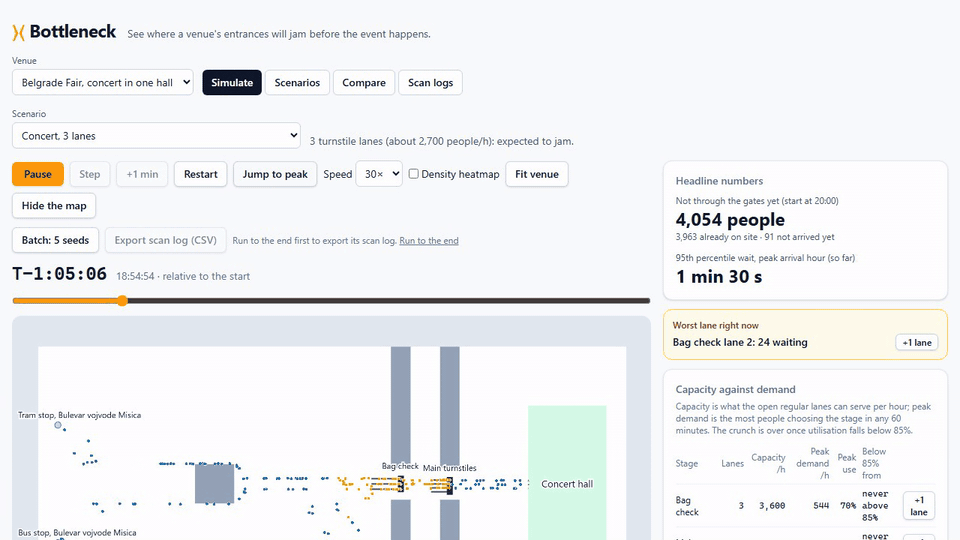
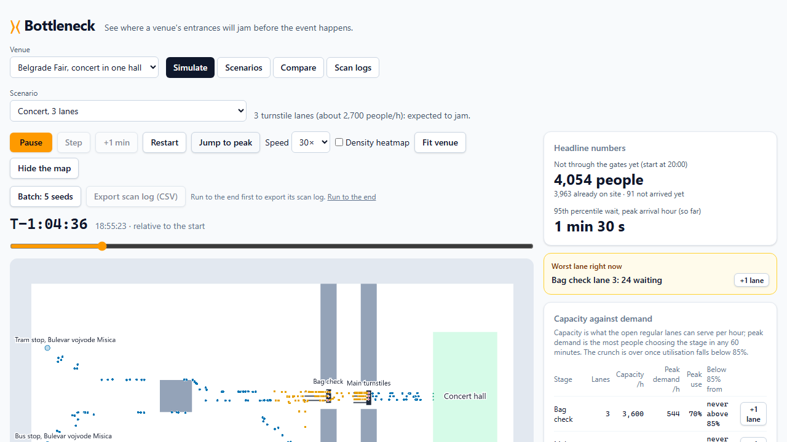

# Bottleneck

A browser-based simulator that shows where a venue's entrances and car parks will jam **before the event happens**.

Draw the site over a map, place pedestrian gates, security lanes, vehicle barriers and parking, enter how many people and cars you expect, and watch the queues form. Then change something (add a lane, break a gate, swap the barrier type) and compare the results side by side.



**Live demo:** (link added after deployment check)

> **Status:** Phases 0 to 5 are done (the venue editor's core: drawing the pedestrian layout; roads and car parks follow). The engine simulates walking, density-dependent speed, lane choice, queues that spill back, lane failures and scan retries, and cars: roads, barriers, parking, overflow and the exit rush. The web app runs it live (PixiJS, in a Web Worker) on built-in Belgrade Fair examples and a stand-alone car park, lets you edit, save and compare scenarios, and fit service times from scan logs. An optional server (ASP.NET Core + PostgreSQL, run with Docker Compose) adds sharing links and server-side batches and sweeps. Node, Chrome and the server give bit-identical results, checked in CI. Next: the showcase (Phase 6) and a public deployment of the server. See [docs/PROJECT.md](docs/PROJECT.md) for the full status, decisions and roadmap.

## What you can do

- **Load an example:** a concert (4,500 people, 3 or 5 turnstile lanes, or 5 lanes with a failure), a fair day (three gates, a bus burst, a gate reduced), and a stand-alone car park.
- **Cars and parking:** entry and exit barriers (ticket, plate recognition, pay at the barrier), pay machines on foot, a full lot that queues, diverts or turns cars away, and a lot that closes. Fair-day and concert scenarios send part of the crowd by car to car parks beside the venue.
- **Departures:** give a scenario a departure curve and the exit rush is simulated too: people walk back to their cars, pay, drive to the exit barrier and queue there. Compare "pay at the machines" with "pay at the barrier", or a third exit lane.
- **Play, pause, seek:** change the speed, drag the scrubber, or press "Jump to peak"; backward seeks restore engine checkpoints.
- **See the crowd:** people drawn on the map, a density heatmap, lane queues, capacity against demand, and the worst lane named.
- **Edit scenarios:** a library in your browser (create, duplicate, edit, delete, JSON export and import), validated against the JSON Schema; fail or reopen a lane during playback.
- **Compare scenarios** (up to 4) with common random numbers, so differences come from the change and not from luck, with the differences written out in words ("better" / "worse" / "no clear difference").
- **Run a batch of 5 seeds** and see every headline number as a mean with a 95% confidence interval.
- **Scan logs:** export a run's scan log as CSV, import a log, fit the service time and the arrival pattern, and apply them to a new scenario.
- **Draw your own venue** ("Edit venue" tab): walkable areas, obstacles, where people arrive, gate lines and destinations, over a map image calibrated with two clicks; undo/redo; checks in plain sentences (for example a source that cannot reach any gate, computed by the simulation engine itself); saved in your browser and usable in every section.
- **With the server** ("Share & server" tab): publish a venue and get a private edit link and a read-only share link (no accounts; the key stays after `#` in the link); run 20-seed batches, **lane sweeps** ("how many lanes keep the p95 wait under 10 minutes?") and **gate-opening sweeps** ("how late can the gates open and still get 95% inside by the start?") on the server, with a chart of the answer.



## How it's built

- **Engine:** pure TypeScript, with no DOM and no network. The same code runs in a Web Worker in the browser and headless in Node, and gives **bit-identical results** in both. It uses counter-based randomness, in-repo `ln`/`exp`, and an exact-time event queue inside a fixed 0.25 s tick.
- **Web:** Vite + React + TypeScript + Tailwind, deployed as a static site with a strict Content-Security-Policy. The simulation view draws the crowd with PixiJS from snapshots sent by the engine's Web Worker.
- **Examples:** [`packages/examples`](packages/examples) holds the built-in venues and scenarios as schema-valid JSON; a test simulates each one and checks that, for example, 3 lanes jam and 5 lanes cope.
- **Schema:** venue, scenario and run formats are written once as JSON Schema in [`/schema`](schema). Types are generated from them, and CI fails if they are stale.
- **Analysis:** [`packages/analysis`](packages/analysis) holds the statistics (confidence intervals, paired differences) and the scan-log fitting, shared by the comparison and the scan-log tools.
- **Server (optional):** an ASP.NET Core (.NET 10) API with PostgreSQL (EF Core, jsonb documents) does **orchestration and persistence**: it stores venues, scenarios and runs, validates every write against the same JSON Schema, handles share links and edit keys (hashed, constant-time compared), concurrency (ETags), rate limits, quotas and image uploads, and runs a job queue in the database. It never simulates itself: a small stateless Node **sidecar** runs the very same engine, so a server run has the same hash as a browser run. Docker Compose runs it all behind Caddy with backups.

## Run it locally

Requires Node.js 20.19 or newer (24 LTS recommended).

```bash
npm install
npm run dev        # http://localhost:5173
npm run check      # schema check, lint, typecheck, unit and validation tests, build
```

Browser tests (Playwright, Chromium) run against the production build and check that Node and Chrome's Web Worker give the same metrics hash, and that the page loads and plays under the strict Content-Security-Policy:

```bash
npx playwright install chromium   # once
npm run test:e2e                  # builds, serves with `vite preview`, runs the tests
```

The full stack (PostgreSQL, sidecar, API and Caddy) runs with Docker:

```bash
npm run stack:up     # http://localhost:8080, with the "Share & server" tab
npm run stack:down
```

CI runs `npm run check`, a secret scan (gitleaks), `npm run test:e2e`, and the API tests (.NET, with Testcontainers and the real sidecar), each as its own job. The demo GIF above was recorded with `RECORD_DEMO=1 npx playwright test record-demo` (a spec that is skipped otherwise) and converted with ffmpeg.

## Documentation

Everything lives in **[docs/PROJECT.md](docs/PROJECT.md)**: status, decisions, the acceptance checklist, and plain-language "how it works" notes (with interview questions) for each phase. The original specification is in [docs/spec](docs/spec).

All default parameters (walking speed, scan times, barrier times…) are **assumptions, not measurements**, and are labelled as such in the app.
