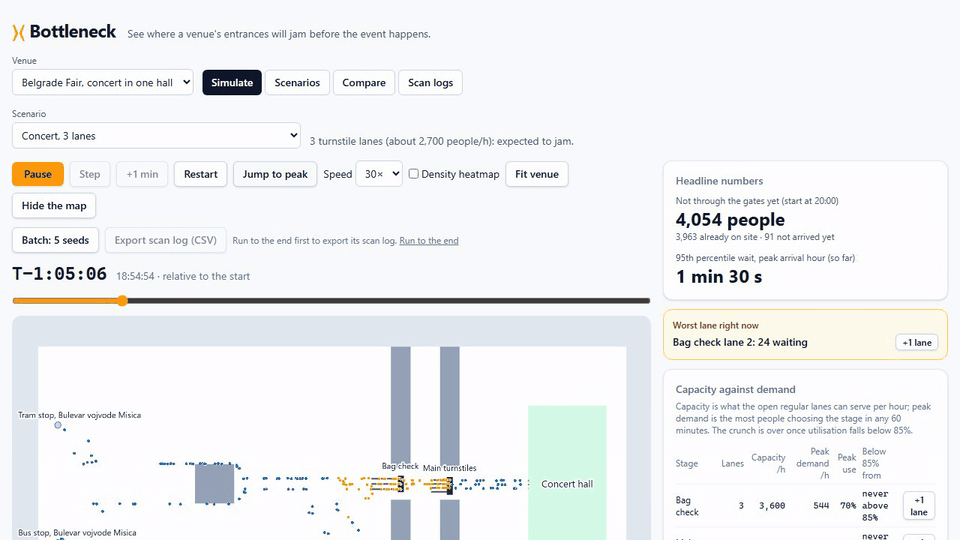
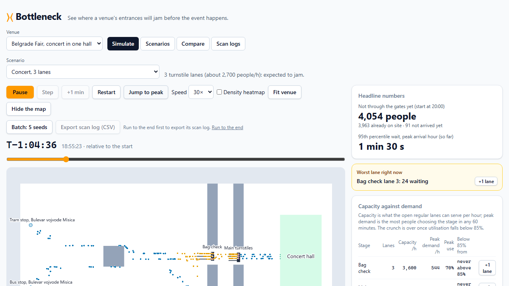

# Bottleneck

A browser-based simulator that shows where a venue's entrances and car parks will jam **before the event happens**.

Draw the site over a map, place pedestrian gates, security lanes, vehicle barriers and parking, enter how many people and cars you expect, and watch the queues form. Then change something (add a lane, break a gate, swap the barrier type) and compare the results side by side.



**Live demo:** (link added after deployment check)

> **Status:** Phases 0 to 2 are done: the engine simulates walking, density-dependent speed, lane choice, queues that spill back, lane failures and scan retries; the web app runs it live (PixiJS, in a Web Worker) on two built-in Belgrade Fair examples, lets you edit and save scenarios, compare them, and fit service times from scan logs. Node and Chrome give bit-identical results, checked in CI. Next is Phase 3 (vehicles and parking). Phase 2 is waiting for the merge to `main`. See [docs/PROJECT.md](docs/PROJECT.md) for the full status, decisions and roadmap.

## What you can do

- **Load an example:** a concert (4,500 people, 3 or 5 turnstile lanes, or 5 lanes with a failure) and a fair day (three gates, a bus burst, a gate reduced).
- **Play, pause, seek:** change the speed, drag the scrubber, or press "Jump to peak"; backward seeks restore engine checkpoints.
- **See the crowd:** people drawn on the map, a density heatmap, lane queues, capacity against demand, and the worst lane named.
- **Edit scenarios:** a library in your browser (create, duplicate, edit, delete, JSON export and import), validated against the JSON Schema; fail or reopen a lane during playback.
- **Compare scenarios** (up to 4) with common random numbers, so differences come from the change and not from luck, with the differences written out in words ("better" / "worse" / "no clear difference").
- **Run a batch of 5 seeds** and see every headline number as a mean with a 95% confidence interval.
- **Scan logs:** export a run's scan log as CSV, import a log, fit the service time and the arrival pattern, and apply them to a new scenario.



## How it's built

- **Engine:** pure TypeScript, with no DOM and no network. The same code runs in a Web Worker in the browser and headless in Node, and gives **bit-identical results** in both. It uses counter-based randomness, in-repo `ln`/`exp`, and an exact-time event queue inside a fixed 0.25 s tick.
- **Web:** Vite + React + TypeScript + Tailwind, deployed as a static site with a strict Content-Security-Policy. The simulation view draws the crowd with PixiJS from snapshots sent by the engine's Web Worker.
- **Examples:** [`packages/examples`](packages/examples) holds the built-in venues and scenarios as schema-valid JSON; a test simulates each one and checks that, for example, 3 lanes jam and 5 lanes cope.
- **Schema:** venue, scenario and run formats are written once as JSON Schema in [`/schema`](schema). Types are generated from them, and CI fails if they are stale.
- **Analysis:** [`packages/analysis`](packages/analysis) holds the statistics (confidence intervals, paired differences) and the scan-log fitting, shared by the comparison and the scan-log tools.
- **Later:** an ASP.NET Core (.NET 10) API with PostgreSQL for sharing, plus server-side batch runs and lane sweeps (Phase 4).

## Run it locally

Requires Node.js 20.19 or newer (24 LTS recommended).

```bash
npm install
npm run dev        # http://localhost:5173
npm run check      # schema check, lint, typecheck, unit and validation tests, build
```

Browser tests (Playwright, Chromium) run against the production build and check that Node and Chrome's Web Worker give the same metrics hash, and that the page loads and plays under the strict Content-Security-Policy:

```bash
npx playwright install chromium   # once
npm run test:e2e                  # builds, serves with `vite preview`, runs the tests
```

CI runs both: `npm run check` and `npm run test:e2e` (as a separate job). The demo GIF above was recorded with `RECORD_DEMO=1 npx playwright test record-demo` (a spec that is skipped otherwise) and converted with ffmpeg.

## Documentation

Everything lives in **[docs/PROJECT.md](docs/PROJECT.md)**: status, decisions, the acceptance checklist, and plain-language "how it works" notes (with interview questions) for each phase. The original specification is in [docs/spec](docs/spec).

All default parameters (walking speed, scan times, barrier times…) are **assumptions, not measurements**, and are labelled as such in the app.
